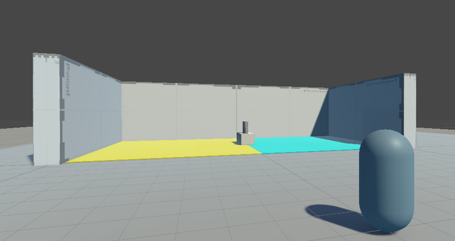

# GAMEDEV - Gameplay Knockdown Game

**Student Name:** Jenrick Lim

---

### Video Showcase

Please access the screen recording of the gameplay demo either in the **`Documentations/`** folder (`Documentations/Gameplay Knockdown.mp4`) or through this link: https://drive.google.com/file/d/1vfM0w_AM2ifaRm5k8xqaB_1wG63fmLHx/view?usp=drive_link

---

## Level & Game Overview

This project is a carnival-style ball throw and can knockdown game in Unity. Players switch between two distinct gameplay platforms: an **Unlimited Practice Mode** with stationary targets and a **Challenge Mode** featuring a moving target platform, limited balls, and a countdown timer.

---

## Key Features & Mechanics

### Game Modes
- **Unlimited:** Practice mode with infinite balls and a stationary target platform.
- **Challenge:** Competitive mode with a moving platform, a strict timer, and limited balls.

### Can
- Stays locked as kinematic so the pyramid doesn't topple while the platform moves.
- Resets local positions and rotations back to original coordinates on round restart.

### Ball
- Instantiated at camera view and launched with impulse force on mouse click.
- Tracks remaining balls and updates the `GameManager` per throw.
- Transfers kinetic energy to cans upon collision to knock them down.

### Game Manager
- Central singleton tracking time, remaining balls, knocked cans, win/loss states, and full level resets.

## Gameplay Preview

